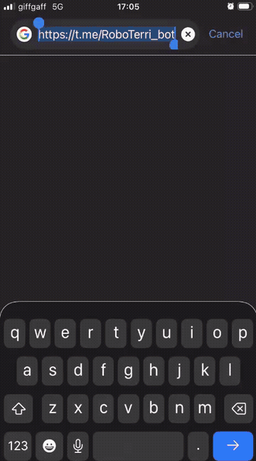

# Conversational interfaces

## RoboTerri

<p align="center">
  
  <br><em>RoboTerri — ClawBio's messaging-facing agent, inspired by <a href="https://en.wikipedia.org/wiki/Teresa_Attwood">Prof. Teresa K. Attwood</a></em>
</p>

**RoboTerri** is the messaging-facing interface to ClawBio. It currently runs over Telegram, letting an external LLM interpret free-text requests and translate them into local ClawBio skill executions. The public demo bot runs against a real human genome ([Manuel Corpas](https://en.wikipedia.org/wiki/Manuel_Corpas), CC0 public domain). Named after [Prof. Teresa K. Attwood](https://en.wikipedia.org/wiki/Teresa_Attwood) — a pioneer of bioinformatics education, founding Chair of GOBLET, and winner of the 2021 ISCB Outstanding Contributions Award.

<p align="center">
  <a href="https://t.me/RoboTerri_bot">
    
  </a>
  <br>
  <a href="https://t.me/RoboTerri_bot"><strong>Try RoboTerri now — no install needed →</strong></a>
</p>

Ask it anything:

- **"Give me my pharmacogenomic summary"** — analyses 12 genes, 51 drugs
- **"What diseases am I at risk for?"** — polygenic risk scores for 6 conditions
- **Send a photo of any medication** — checks CYP2D6/CYP2C19 metaboliser status
- `/demo pharmgx` `/demo prs` `/demo nutrigx` `/demo compare` `/demo profile`

```
You:        [send 23andMe file]
RoboTerri:  Running PharmGx Reporter...
            CYP2D6 *4/*4 — Poor Metabolizer → 10 drugs AVOID
            [report.md attached]
            [3 figures attached]

You:        [send photo of warfarin packet]
RoboTerri:  Warfarin detected. Running Drug Photo skill...
            CYP2C9 *1/*2 · VKORC1 High Sensitivity
            AVOID — DO NOT USE at standard dose.

You:        run gwas-lookup rs3798220
RoboTerri:  Querying 9 databases...
            rs3798220 (LPA) — coronary artery disease, Lp(a) levels.
            eQTL in liver (GTEx). gnomAD MAF 0.07.
```

RoboTerri auto-detects file type (23andMe `.txt`, AncestryDNA `.csv`, VCF, FASTQ) and routes to the right skill via the Bio Orchestrator. Photos of medications trigger the Drug Photo skill automatically — no command needed.

> **[Install your own RoboTerri](tutorial-roboterri-install.md)**: Set up your own Telegram adapter running ClawBio skills in ~20 minutes.

## OpenClaw Gateway

The **OpenClaw gateway** is the direct, self-hosted browser/webchat interface for ClawBio. Instead of routing through Telegram, it places a chat client directly in front of a local gateway that orchestrates ClawBio skill calls on your machine.

This is the strongest privacy-preserving conversational setup in the ClawBio stack. It avoids reliance on external messenger platforms, keeps operational control in your hands, and lets the LLM remain at the orchestration layer while the biological analysis itself stays local.

See [docs/custom-domain-webchat.md](custom-domain-webchat.md) for a plain-language walkthrough of the gateway and how to expose a browser-based webchat on your own domain.
